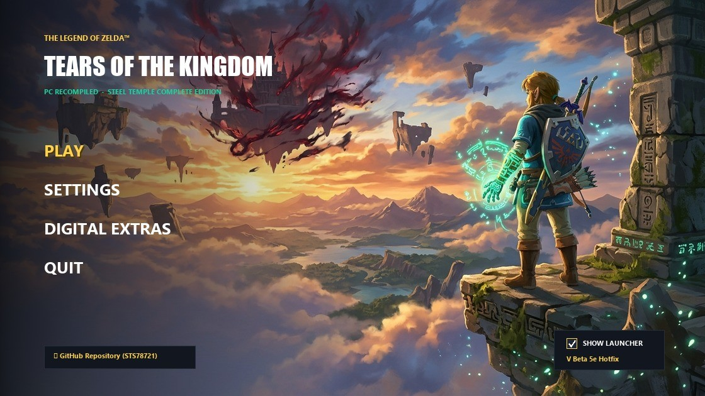

# 🗡️ SteelTempSaint's ToTK Recomp 🎮⚡
### *Transforming Tears of the Kingdom into a Flagship Modern PC Experience*

[](https://github.com/STS78721/totk-pc-recomp-SteelTempleBuild/releases/latest)
[](https://github.com/STS78721/totk-pc-recomp-SteelTempleBuild/releases/latest)
[](https://github.com/STS78721/totk-pc-recomp-SteelTempleBuild)
[](https://github.com/STS78721/totk-pc-recomp-SteelTempleBuild)
[](https://github.com/STS78721/totk-pc-recomp-SteelTempleBuild)
[](https://github.com/STS78721/totk-pc-recomp-SteelTempleBuild/issues)

> [!IMPORTANT]
> **No copyrighted game files are included.** You need your own legally obtained copy of *The Legend of Zelda: Tears of the Kingdom*, dumped from your console: base game and update **v1.4.3** (`ExeFS` / `RomFS`). The executable is compiled and linked on your local machine.

---

## 🌟 Our Vision: What We Want to Achieve

**SteelTempSaint's ToTK Recomp** is an enthusiast-driven, high-performance static recompilation fork of *The Legend of Zelda: Tears of the Kingdom* (Nintendo Switch) for native Windows and Linux x86-64.

Our goal is not just to run the game on PC—it is to **elevate *Tears of the Kingdom* into a native, flagship PC title** that leverages the full power of modern hardware:
- **Next-Gen Immersion:** Bridging the physical gap between player and world with native PS5 DualSense 4-channel audio streaming, dynamic adaptive trigger resistance, and voice-coil tactile feedback.
- **State-of-the-Art Rendering:** Combining deep neural reconstruction, multi-vendor AI upscaling, and low-latency presentation pipelines for razor-sharp 4K/8K presentation at ultra-high framerates.
- **Future-Forward Graphics:** Actively pioneering real-time lighting advancements (RTGI, Path Tracing, and modern PBR pipelines) to realize Hyrule in its most breathtaking form.
- **A Completely Community-Guided Project:** Built for players, with players. Every design choice, trigger curve, audio filter, and visual toggle is driven by user testing, discussion, and direct feedback.

---

## 🎮 What Makes This Build Unique (Current Feature Highlights)

### 🕹️ Sony PlayStation 5 DualSense Native Integration
* **4-Channel Haptic Streaming:** Real-time spatial separation sending high-frequency environmental audio cues (weapon swings, Zonai motor vibrations, thunder, and explosions) directly through DualSense dual voice-coil actuators.
* **Dynamic Adaptive Triggers:** 
  - **Bows:** Real-time drawstring resistance tension with tactile snap-release upon firing.
  - **Shields & Guarding:** Progressive tension buildup that kicks back dynamically when parrying or absorbing heavy strikes.
* **Controller Battery Telemetry:** Real-time battery indicator (`[🔋 XX%]` / `[⚡ Charging]`) seamlessly rendered in the performance overlay next to the controller prompt icon.

### 🖥️ Standalone Nixxes/Sony-Style PC Launcher (`TotKLauncher.exe`)
<p align="center">
  
</p>

* **1-Click Update & Apply:** Automated update detection with CRC verification, preserving custom settings.
* **Pre-Warm Vulkan Shaders:** Multi-threaded shader pipeline pre-compilation directly into GPU driver cache.
* **Pre-Flight Startup Protection:** Automatically checks that `exefs/` and `romfs/` exist with a 1-click *Open Game Folder* prompt if missing, eliminating silent crashes.
* **Steam Deck & Handheld 1-Click Preset:** Optimized 1280×800 16:10 resolution, 40 FPS target limiter, and FSR balanced scaling.
* **Ultrawide HUD Auto-Patcher:** 1-click automatic patching for 21:9 and 32:9 displays to prevent stretched UI elements.
* **Save Backup Vault & Mod Manager:** Instant timestamped snapshots and simple mod enable/disable toggles.

### ⚡ Upstream v0.3.12 Engine Sync & Performance
* **Upstream Sync:** Full merge with upstream `v0.3.12` and latest `dev` pipeline improvements (dynamic state delta tracking, scratch uniform overlays, texture heap expansion for HD texture packs, VRAM pressure auto-management, and native mouse camera with menu cursor).
* **Native NVIDIA Reflex (`VK_NV_low_latency2`):** Low-latency frame pacing with boost mode support to minimize input-to-photon latency on NVIDIA RTX hardware.
* **Multi-Vendor Upscaler Hub:** Drop-in support for NVIDIA DLSS 4.5, AMD FSR 4.1.2, and Intel XeSS.

---

## 📥 Quick Start & Downloads

Grab the latest prebuilt packages from our **[Latest Release (Beta 6.1a)](https://github.com/STS78721/totk-pc-recomp-SteelTempleBuild/releases/tag/Beta-6.1a)**:

### 🎮 1. New Players (Fresh Standalone Setup)
👉 **Download: [`SteelTemple-TotK-Beta6.1a-Portable-StandAlone.zip`](https://github.com/STS78721/totk-pc-recomp-SteelTempleBuild/releases/download/Beta-6.1a/SteelTemple-TotK-Beta6.1a-Portable-StandAlone.zip)** (~505 MB)
1. Extract the archive into your chosen game folder (e.g. `C:\Games\TotK`).
   - *Includes `TotKLauncher.exe`, `totk.exe`, `SDL3.dll`, vendor upscalers (DLSS 4.5, DLSS-NR, XeSS, FSR), DualSense haptics, and aspect ratio patches.*
2. Copy **both** your dumped **`exefs`** and **`romfs`** folders (from your legally owned 1.4.3 game dump) directly into this folder.
   Your game directory should look like this:
   ```text
   GAME/
   ├── totk.exe
   ├── TotKLauncher.exe
   ├── SDL3.dll, libopus-0.dll, etc.
   ├── exefs/            <-- Contains main.npdm, main, sdk, subsdk0 (from 1.4.3 update)
   ├── romfs/            <-- Contains game assets (or romfs.bin)
   └── ...
   ```
3. Launch **`TotKLauncher.exe`** to configure graphics, pre-warm shaders, apply Ultrawide HUD fixes if needed, and hit **Play**!

---

### ⚡ 2. Upgrading Existing Builds (Drop-in Update)
👉 **Download: [`SteelTemple-TotK-Beta6.1a-Update.zip`](https://github.com/STS78721/totk-pc-recomp-SteelTempleBuild/releases/download/Beta-6.1a/SteelTemple-TotK-Beta6.1a-Update.zip)** (~117 MB)
1. Extract and overwrite files directly into your existing game directory.
2. Preserves all your save files, custom `totk.ini` configuration, and mods.

---

### 🛠️ 3. Setup & Configuration Wizard (Companion Tool)
👉 **Download: [`SteelTemple-TotK-Beta6.1a-Full-Setup-Wizard.exe`](https://github.com/STS78721/totk-pc-recomp-SteelTempleBuild/releases/download/Beta-6.1a/SteelTemple-TotK-Beta6.1a-Full-Setup-Wizard.exe)** (~64 MB)
- Interactive Windows wizard providing 1-click Desktop shortcut creation, emulator save migration (Yuzu, Ryujinx), and controller UI prompt selection.

---

*Thank you to all contributors, testers, and players building the ultimate Tears of the Kingdom experience!* 🗡️🛡️
